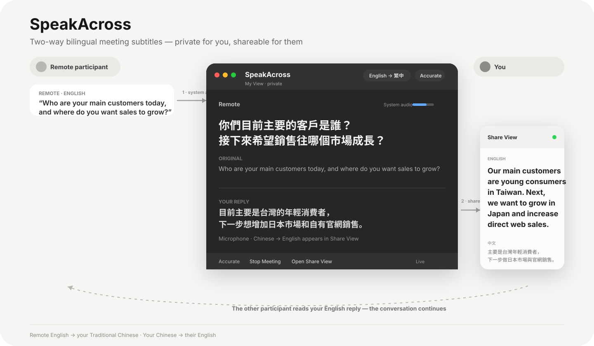

# SpeakAcross

[English](README.md) | 繁體中文

**SpeakAcross 是一款開源的原生 macOS 雙語會議即時字幕工具，專為英文 ↔ 繁體中文 / 簡體中文的即時跨語言溝通而設計。**

<p align="center">
  
</p>

<p align="center"><em>My View 僅供自己閱讀；Share View 專為螢幕分享而設計。</em></p>

SpeakAcross 會各自獨立擷取對話雙方的音訊：

- 遠端會議 / 系統音訊 → 語音轉錄 → 翻譯成你的語言（顯示於 **My View**）
- 本地麥克風 → 語音轉錄 → 連續翻譯字幕（顯示於 **Share View**）

私密的 **My View** 讓你即時看懂對方的發言（並可透過 **History** 獨立視窗分頁查看 Listening / Speaking 的原文與翻譯對照）；獨立的 **Share View** 則專為螢幕分享設計，讓對方直接閱讀你翻譯後的連續字幕，同時不會曝光你的私人視窗。

> 用自己的母語自然發言，用熟悉的語言即時閱讀對方內容，並安全地分享翻譯字幕。

SpeakAcross 目前是一個專注於即時溝通的 macOS Alpha 專案，而不是會議錄音、會議筆記或 AI 代答工具。

## 為什麼想做 SpeakAcross？

都已經是 AI 時代了，跨語言溝通不應該還是障礙。每個人都應該能用自己的原生語言自然表達，彼此溝通無礙。

多數即時字幕工具都假設「所有人想看的都是同一份字幕」，但在雙語會議裡，雙方其實需要不同的畫面與資訊。

因此 SpeakAcross 採用雙視窗設計：

```text
遠端與會者說英文
        │
        ▼
  macOS 系統音訊
        │
        ▼
   SpeakAcross
        │
        ├── My View
        │   英文原文
        │   繁體中文翻譯
        │
        └── 僅限自己觀看（私密）


你用中文發言
      │
      ▼
    麥克風
      │
      ▼
  SpeakAcross
      │
      └── Share View
          連續英文翻譯字幕
          適合直接螢幕分享
```

這是一個純粹的**即時翻譯溝通工具**，不是面試代答器或會議機器人。

## 主要功能

- 原生 Swift / SwiftUI macOS 應用程式
- 透過 `ScreenCaptureKit` 擷取 macOS 系統音訊
- 透過 `AVFoundation` 擷取麥克風輸入
- 即時 **英文 ↔ 繁體中文 / 簡體中文** 雙向翻譯
- 可於 **Settings** 自由設定 Listening 與 Speaking 的語言方向與斷句節奏
- 獨立的私人 **My View**、連續字幕 **Share View**，以及 **Listening / Speaking** 分頁對照的 **History** 視窗
- 系統音訊與麥克風即時音量狀態顯示
- 可自選麥克風與 AI 輸出音訊裝置
- OpenAI BYOK（自備 API Key），支援 macOS Keychain 安全儲存
- 不需註冊 SpeakAcross 帳號、不依賴自建後端、不含分析追蹤
- 預設不錄製儲存音檔；每次會議可將文字逐字稿存於本機 `~/Documents/SpeakAcross/Transcripts/`
- 客戶端靜音閘門（Silence Gate），減少空白時段的 API 音訊傳輸與費用
- Session 連線用量 / 預估費用顯示與自動斷線重連機制
- 內建自動化 E2E、語意回歸與長時間穩定性測試工具

## 系統需求

- macOS 14.0+（Sonoma 或更新版本）
- Xcode / Swift 6 工具鏈
- OpenAI API Key（需具備 Realtime API 權限）
- **螢幕與系統音訊錄製（Screen & System Audio Recording）** 權限
- **麥克風（Microphone）** 權限

開會時強烈建議配戴**耳機**，避免喇叭播放的遠端聲音回傳進麥克風造成回音或自我翻譯循環。

## 快速開始

> 完整設定、權限授權與排錯指南請見 [設定與啟動指南 (Setup & Launch Guide)](Docs/setup-and-launch.md)。  
> 如果想讓 AI 開發助手（Claude Code、Codex、Cursor、Antigravity 等）直接幫你設定並啟動，請讓它讀取 [Agent.md](Agent.md)。

下載專案後進入目錄並建立本機環境設定檔：

```sh
cd speakacross
cp .env.example .env
```

在 `.env` 中填入你的 OpenAI API Key：

```text
OPENAI_API_KEY=your_key_here
```

執行測試、打包並啟動 macOS App：

```sh
swift test
./Scripts/build-macos-app.sh
open -n ./SpeakAcross.app
```

首次啟動時，macOS 會請求授權：

1. 麥克風存取權限
2. 螢幕與系統音訊錄製權限

若在「系統設定 → 隱私權與安全性」變更權限，請先完全結束（`Cmd+Q`）再重新開啟 SpeakAcross。

## 會議中使用方式

1. 開啟 SpeakAcross，在 **Audio** 確認麥克風與輸出裝置，並在 **Settings** 設定好 Listening / Speaking 語言方向。
2. 點擊 **Start Meeting**。
3. 加入 Zoom、Google Meet、Teams 或其他視訊會議。
4. 在 **My View** 即時查看對方的語音翻譯。
5. 點擊 **Open Share View**，並在視訊軟體中**僅分享 Share View 視窗**。
6. 用你的母語正常說話，對方即可在 Share View 看到連續的翻譯字幕；若需要對照原文，可隨時點擊 **History** 視窗切換 **Listening** / **Speaking** 分頁查看。

## 自備金鑰（BYOK）與隱私

SpeakAcross 採用 BYOK（Bring Your Own Key）模式，開發與執行時的設定讀取順序為：

```text
Shell 環境變數 -> .env -> macOS Keychain
```

- 也可直接在 App 介面的 **Connection** 面板將金鑰存進 macOS Keychain（`.env` 已被 `.gitignore` 忽略，請勿提交至 Git）。
- 音訊與文字直接由你的 Mac 傳送至 OpenAI API，不經過任何 SpeakAcross 中繼伺服器。
- 預設不儲存原始音訊；會議結束後會在 `~/Documents/SpeakAcross/Transcripts/` 產生該場次的 Markdown 逐字稿。更多細節請見 [Docs/privacy.md](Docs/privacy.md)。

## 測試方式

### 單元測試

```sh
swift test
```

### 付費自動化 E2E（需明確授權）

以下測試會實際呼叫付費 OpenAI API，因此預設會被阻擋，需明確加上 `SPEAKACROSS_ALLOW_PAID_E2E=1` 才會執行：

```sh
SPEAKACROSS_ALLOW_PAID_E2E=1 ./Scripts/run-full-e2e.sh
SPEAKACROSS_ALLOW_PAID_E2E=1 ./Scripts/run-golden-e2e.sh
```

更多測試細節請見 [Docs/e2e-testing.md](Docs/e2e-testing.md)、[Docs/full-e2e.md](Docs/full-e2e.md) 與 [Docs/golden-e2e.md](Docs/golden-e2e.md)。

## 專案架構

```text
.
├── Sources/
│   ├── SpeakAcrossApp/          # macOS SwiftUI 應用程式
│   ├── SpeakAcrossCore/         # Realtime 連線、字幕時間軸、核心邏輯
│   ├── SpeakAcrossE2EAgent/     # 互動式英文面試官測試代理
│   └── SpeakAcrossFullE2E/      # 自動化 E2E 測試工具
├── Tests/
│   └── SpeakAcrossCoreTests/    # 核心單元測試
├── Scripts/                     # 打包、簽署與 E2E 執行腳本
├── Docs/                        # 架構、隱私、設定與測試文件
├── Agent.md                     # 供 LLM 開發助手協助設定與操作的手冊
├── Package.swift
├── LICENSE
├── README.md
└── README-TW.md
```

## 設計原則與非目標

- **專注於即時溝通**：翻譯不腦補未說出的內容，保留專有名詞、數字、否定語氣與中英夾雜詞彙。
- **隱私隔離**：私人閱讀視窗（`My View` / `History`）與對外分享視窗（`Share View`）分離，不綁帳號、不掛會議外掛、不取代你的聲音。
- **非目標**：不提供面試自動代答、AI 話術建議、聲音複製或 TTS 變聲替換。

## 授權與免責聲明

- **授權條款**：[Apache License 2.0](LICENSE)
- **安全性回報**：請見 [SECURITY.md](SECURITY.md)
- **貢獻指南**：歡迎提交 Issue 與 Pull Request，請見 [CONTRIBUTING.md](CONTRIBUTING.md)
- **免責聲明**：SpeakAcross 目前為實驗性軟體，即時語音轉錄與翻譯可能存在遺漏或誤差，請勿將其作為法律、醫療、金融或高風險情境的唯一依據。
