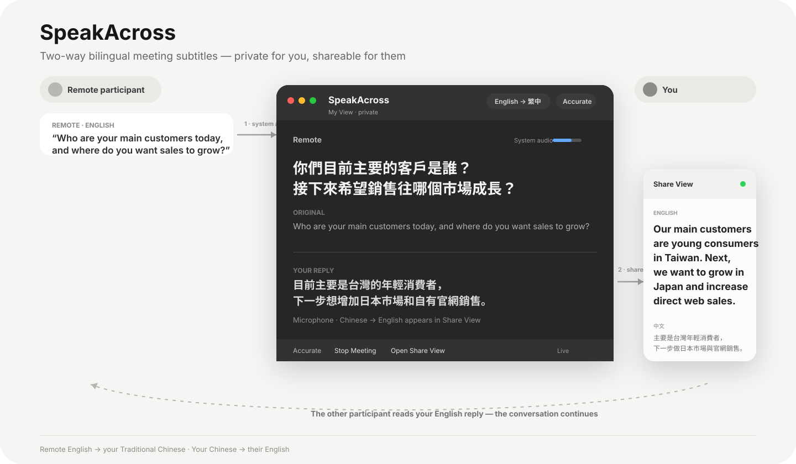

# SpeakAcross

English | [繁體中文](README-TW.md)

**SpeakAcross is an open-source, native macOS bilingual meeting subtitle app for real-time English ↔ Traditional / Simplified Chinese communication.**

<p align="center">
  
</p>

<p align="center"><em>My View stays private. Share View is designed for screen sharing.</em></p>

It captures both sides of a conversation independently:

- remote meeting/system audio → English transcript → Traditional Chinese translation
- local microphone → Chinese transcript → English translation

The private **My View** helps you understand the other side (with a separate **History** popout for Listening / Speaking transcript comparison). A separate **Share View** is designed to be screen-shared so the other participant can read your continuous translated subtitles without exposing your private view.

> Speak naturally. Read the other side in your language. Share your translation without exposing your private view.

SpeakAcross is currently a macOS alpha focused on live communication rather than recording, meeting notes, or AI-generated answers.

## Why SpeakAcross?

In the AI era, cross-language communication shouldn't still be a barrier. Everyone should be able to speak naturally in their own native language and understand each other without friction.

Most live-caption tools assume everyone wants to see the same transcript. That breaks down in bilingual meetings where each side needs something different.

SpeakAcross uses two views instead:

```text
Remote participant speaks English
            │
            ▼
      macOS system audio
            │
            ▼
       SpeakAcross
            │
            ├── My View
            │   English original
            │   Traditional Chinese translation
            │
            └── Private to you


You speak Chinese
      │
      ▼
  Microphone
      │
      ▼
 SpeakAcross
      │
      └── Share View
          Continuous English translation
          safe to screen-share
```

This is intentionally a **translation tool**, not an interview-answer generator or meeting copilot.

## Features

- Native Swift / SwiftUI macOS app
- macOS system-audio capture with ScreenCaptureKit
- microphone capture with AVFoundation
- real-time English ↔ Traditional Chinese / Simplified Chinese translation
- configurable Listening and Speaking language directions
- separate private My View, continuous-translation Share View, and Listening/Speaking History popout
- original transcript + translated text comparison in My View and History
- system-audio and microphone activity indicators
- selectable microphone and AI output devices
- OpenAI BYOK (Bring Your Own Key)
- API key storage in Apple Keychain
- no SpeakAcross account required
- no audio recording to disk by default
- local per-meeting Markdown transcript saved under `~/Documents/SpeakAcross/Transcripts/`
- no analytics requirement
- local silence gating in Fast mode to reduce idle API audio usage
- session usage / estimated API cost display
- automatic Realtime session recovery
- automated E2E, semantic regression, and soak-test tooling

## Translation modes

SpeakAcross currently provides two translation paths.

### Accurate — default

Designed for interviews, technical meetings, and conversations where preserving meaning matters more than the earliest possible partial subtitle.

- turn-based Realtime interpretation
- `gpt-live-transcribe` source transcription
- `gpt-realtime-2.1` text-only interpretation by default
- server VAD turn detection
- technical terminology guidance
- Traditional Chinese normalization
- stronger emphasis on names, numbers, conditions, negation, thresholds, and domain terminology

### Fast

Designed for lower time-to-first-caption.

- `gpt-realtime-translate`
- continuous streaming translation
- `gpt-live-transcribe` source transcription
- `elapsed_ms`-based source/translation alignment
- local PCM silence gate to avoid continuously sending long idle periods

Fast mode favors latency. Accurate mode is the recommended default for real meetings.

## Architecture

```text
                         ┌─────────────────────┐
Meeting / browser audio ─► SystemAudioCapturer │
                         │ ScreenCaptureKit    │
                         └──────────┬──────────┘
                                    │ PCM16 / 24 kHz
                                    ▼
                           Realtime session
                                    │
                           English → zh-Hant
                                    │
                                    ▼
                                My View


                         ┌─────────────────────┐
Microphone ──────────────► MicrophoneCapturer  │
                         │ AVAudioEngine       │
                         └──────────┬──────────┘
                                    │ PCM16 / 24 kHz
                                    ▼
                           Realtime session
                                    │
                            Chinese → English
                                    │
                                    ▼
                               Share View
```

The production app sends audio directly from the macOS client to OpenAI. There is no SpeakAcross backend in the current architecture.

## Privacy model

SpeakAcross is built around a local-first application architecture.

By default:

- audio is not recorded to disk
- finalized meeting captions are saved locally as a Markdown transcript
- there is no SpeakAcross account
- there is no transcript backend
- there is no analytics requirement
- the OpenAI API key is stored locally in Apple Keychain
- the API key is never shown in Share View
- SpeakAcross excludes its own process audio from system-audio capture

Audio and text sent to OpenAI are governed by the user's OpenAI account and applicable OpenAI policies.

See [Docs/privacy.md](Docs/privacy.md).

## Requirements

- macOS 14+
- Xcode / Swift 6 toolchain
- an OpenAI API key
- Screen & System Audio Recording permission
- Microphone permission

For meetings, headphones are strongly recommended to reduce acoustic feedback and accidental recapture.

## Quick start

> For full configuration, permissions, and troubleshooting details, see [Setup & Launch Guide](Docs/setup-and-launch.md).  
> Want an LLM coding assistant (Claude Code, Codex, Cursor, Antigravity, etc.) to configure and launch it for you? Point it to [Agent.md](Agent.md).

Clone the repository, enter the project directory, and create a local environment file:

```sh
cd speakacross
cp .env.example .env
```

Add your OpenAI API key to `.env`:

```text
OPENAI_API_KEY=your_key_here
```

Build and launch the macOS app:

```sh
swift build
swift test
./Scripts/build-macos-app.sh
open SpeakAcross.app
```

On first launch, macOS may ask for:

1. Microphone access
2. Screen & System Audio Recording access

After changing a privacy permission, fully quit and reopen SpeakAcross.

## Using SpeakAcross in a meeting

1. Open SpeakAcross.
2. Choose **Accurate** unless you specifically need Fast mode.
3. Select the microphone you want to use.
4. Click **Start Meeting**.
5. Start or join Zoom, Google Meet, Teams, or another meeting app.
6. Watch **My View** for remote English → Traditional Chinese.
7. Click **Open Share View**.
8. Share only the Share View window in your meeting app.
9. Speak Chinese normally; the other participant reads the English translation.

The system-audio meter in My View indicates whether SpeakAcross is receiving remote meeting audio. The microphone meter indicates whether your local speech path is active.

## Bring Your Own Key

SpeakAcross currently uses a BYOK model.

Configuration precedence during development is:

```text
shell environment -> .env -> macOS Keychain
```

The production UI can store the API key in Apple Keychain.

The local `.env` file is ignored by Git and should never be committed.

## Meeting transcripts

Each **Start Meeting → Stop Meeting** session creates its own local Markdown transcript in:

```text
~/Documents/SpeakAcross/Transcripts/
```

The file includes:

- meeting start/end time
- translation mode
- Listening language direction
- Speaking language direction
- finalized original transcript for each turn
- finalized translation for each turn
- relative timestamps for the conversation

Raw audio is not written to the transcript directory. After stopping a meeting, **Open Transcripts** opens the folder in Finder.

## API usage and cost controls

Realtime speech APIs can incur noticeable cost during long development sessions, so SpeakAcross includes several protections.

### Fast mode silence gating

Fast mode applies a client-side PCM silence gate before audio is sent to the translation/transcription sessions.

Default tuning:

```text
SPEAKACROSS_FAST_GATE_DBFS=-48
SPEAKACROSS_FAST_GATE_PREROLL_MS=250
SPEAKACROSS_FAST_GATE_HANGOVER_MS=700
```

The pre-roll preserves the start of speech, while the hangover avoids clipping the end of a phrase.

### Session usage display

The app exposes session usage information in My View.

- Fast mode: actual post-gate API audio duration + estimated cost for the default models
- Accurate mode: estimated cost using server-reported Realtime token usage and transcription duration

If custom models are configured, SpeakAcross avoids showing a misleading fixed-price estimate.

### Paid automated tests

Automated E2E tests use real OpenAI APIs. They are blocked unless you explicitly opt in:

```sh
SPEAKACROSS_ALLOW_PAID_E2E=1 ./Scripts/run-full-e2e.sh
```

This guard also exists in the E2E executable itself so accidentally bypassing the shell wrapper does not silently start a paid run.

## Development configuration

`.env.example` documents the supported development settings:

```text
OPENAI_API_KEY=
SPEAKACROSS_TRANSLATION_MODEL=gpt-realtime-translate
SPEAKACROSS_TRANSCRIPTION_MODEL=gpt-live-transcribe
SPEAKACROSS_AGENT_MODEL=gpt-realtime-2.1
SPEAKACROSS_ACCURATE_MODEL=gpt-realtime-2.1
SPEAKACROSS_DEFAULT_MODE=accurate
SPEAKACROSS_ACCURATE_VAD_SILENCE_MS=1200
SPEAKACROSS_FAST_GATE_DBFS=-48
SPEAKACROSS_FAST_GATE_PREROLL_MS=250
SPEAKACROSS_FAST_GATE_HANGOVER_MS=700
```

You can use a different environment file:

```sh
SPEAKACROSS_ENV_FILE=/path/to/file ./Scripts/build-macos-app.sh
```

## Testing

### Unit tests

```sh
swift test
```

The core tests cover caption buffering, source/translation alignment, Traditional Chinese normalization, session recovery, audio-device selection, and Fast-mode silence gating.

### Interactive microphone + system-audio E2E

SpeakAcross includes a developer-only English interviewer agent for exercising the real hardware loop.

```sh
./Scripts/run-e2e-agent.sh
```

Run SpeakAcross at the same time. The interviewer listens through your selected microphone and responds in spoken English through the selected output device.

This validates:

```text
Chinese microphone
    ↓
SpeakAcross Share View
    ↓
English translation

English AI audio
    ↓
macOS system audio
    ↓
SpeakAcross My View
    ↓
Traditional Chinese translation
```

See [Docs/e2e-testing.md](Docs/e2e-testing.md).

### Autonomous full E2E

```sh
SPEAKACROSS_ALLOW_PAID_E2E=1 ./Scripts/run-full-e2e.sh
```

The autonomous harness runs two AI participants through the production translation path and checks both translation directions, source transcript presence, turn segmentation, alignment, and latency.

See [Docs/full-e2e.md](Docs/full-e2e.md).

### Semantic golden regression

```sh
SPEAKACROSS_ALLOW_PAID_E2E=1 ./Scripts/run-golden-e2e.sh
```

Accurate-mode server-VAD regression:

```sh
SPEAKACROSS_ALLOW_PAID_E2E=1 ./Scripts/run-accurate-vad-e2e.sh
```

The golden set focuses on semantic fidelity, technical terminology, numeric fidelity, source-ASR fidelity, and Traditional Chinese output.

See [Docs/golden-e2e.md](Docs/golden-e2e.md).

### Soak test

```sh
SPEAKACROSS_ALLOW_PAID_E2E=1 \
SPEAKACROSS_SOAK_REPEAT=10 \
./Scripts/run-soak.sh
```

## Repository structure

```text
.
├── Sources/
│   ├── SpeakAcrossApp/          # macOS SwiftUI app
│   ├── SpeakAcrossCore/         # Realtime sessions, captions, shared logic
│   ├── SpeakAcrossE2EAgent/     # interactive English interviewer
│   └── SpeakAcrossFullE2E/      # autonomous E2E harness
├── Tests/
│   └── SpeakAcrossCoreTests/
├── Scripts/
│   ├── build-macos-app.sh
│   ├── build-e2e-agent-app.sh
│   ├── run-e2e-agent.sh
│   ├── run-full-e2e.sh
│   ├── run-golden-e2e.sh
│   └── run-soak.sh
├── Docs/
├── Package.swift
├── LICENSE
└── README.md
```

## Design principles

- communication first, not meeting automation
- translation should never fabricate unspoken content
- preserve names, numbers, negation, technical terms, and code-switching
- original transcript remains available for verification
- private listening UI and public sharing UI stay separate
- no audio recording by default
- no persistent transcript storage by default
- no hidden backend dependency
- meeting software remains untouched

## Non-goals

SpeakAcross is not intended to provide:

- automatic interview answers
- AI-generated talking points
- voice cloning
- TTS voice replacement
- meeting recording
- permanent transcript archives
- meeting bots that join calls on your behalf
- a Zoom / Meet / Teams plugin
- an account or billing platform

## Current status

**Alpha / active development.**

Currently validated:

- native macOS application
- microphone capture
- ScreenCaptureKit system-audio capture
- English → Traditional Chinese Accurate translation
- Chinese → English Accurate translation
- Fast streaming path
- separate My View and Share View
- external USB audio-device selection
- system/microphone activity meters
- live API usage / cost estimation
- session recovery
- automated full E2E regression
- semantic golden regression

Areas that still need broader real-world validation include long meetings, different microphones/output devices, more meeting applications, more accents, noisy environments, and caption segmentation across natural speech pauses.

## Roadmap

Near-term areas of work:

- improve subtitle readability without over-merging natural speech turns
- broader Zoom / Google Meet / Teams acceptance testing
- better handling of noisy rooms and low-volume system audio
- configurable terminology / glossary profiles
- clearer session diagnostics
- packaging and distribution outside a development build
- iOS exploration where platform capabilities allow it

## Contributing

Issues, bug reports, test cases, and pull requests are welcome.

Useful contributions include:

- real-world meeting-app compatibility reports
- audio-device compatibility reports
- translation regressions with reproducible source phrases
- Swift / SwiftUI improvements
- Realtime API robustness
- caption segmentation and readability improvements
- privacy and security review
- documentation

Please avoid including API keys, private transcripts, or sensitive meeting audio in bug reports.

See [CONTRIBUTING.md](CONTRIBUTING.md) if present for project-specific contribution guidance.

## Security

Do not commit API keys or `.env` files.

If you discover a vulnerability that could expose credentials, audio, transcripts, or other private meeting data, please avoid posting sensitive exploitation details publicly until the issue can be reviewed.

See [SECURITY.md](SECURITY.md) if present.

## License

SpeakAcross is licensed under the [Apache License 2.0](LICENSE).

## Disclaimer

SpeakAcross is experimental software. Translation and transcription can be incomplete or incorrect. Do not rely on it as the sole source of truth for legal, medical, financial, safety-critical, or other high-stakes communication.
